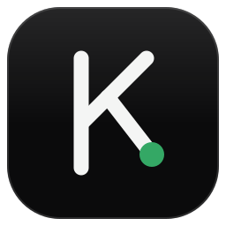

<p align="center">
  
</p>

<h1 align="center">Kara Download Manager</h1>

<p align="center">
  Multi-connection download manager for <b>Linux</b> and <b>Windows</b>, with a browser extension that catches
  downloads and videos for you.
  <br>
  <a href="https://github.com/kamisama-v0/kara-dm/releases">Download</a> ·
  <a href="#browser-extension">Browser extension</a> ·
  <a href="CONTRIBUTING.md">Contributing</a> ·
  <a href="README.id.md">Bahasa Indonesia</a>
</p>

<p align="center">
  <a href="https://github.com/kamisama-v0/kara-dm/actions/workflows/ci.yml"></a>
  <a href="https://github.com/kamisama-v0/kara-dm/releases"></a>
  <a href="LICENSE"></a>
</p>

---

Kara Download Manager (kara-dm) splits each file into up to 16 parallel connections, resumes downloads after
network drops and restarts, and takes over downloads from your browser through the **Kara DM** extension for
Firefox, Chrome and Chromium. It is built with Rust, GTK 4 and libadwaita, and uses
[aria2](https://aria2.github.io/) as its download engine.

It is also compatible with the browser extension of [Neat Download Manager](https://www.neatdownloadmanager.com/)
(and the Kara DM extension works with the NDM app), because both speak the same local protocol.

## Features

- **Fast**: up to 16 connections per file, live segment bar, global speed limit and concurrent-download limit.
- **Reliable**: resumes after crashes, reboots and dropped connections; when a server refuses many
  connections (HTTP 429/503) it continues automatically with fewer.
- **Browser integration**: clicks on download links are handed over with the right cookies and referrer, so
  logged-in and protected downloads work. If kara-dm is not running, the browser keeps the download.
- **Video**: a "Download video" button on top of players, HLS (`.m3u8`) and DASH (`.mpd`) streams, and
  "this page's video" for YouTube, Vimeo, X and more via [yt-dlp](https://github.com/yt-dlp/yt-dlp).
- **Organised**: categories (video, music, archives, documents, programs, images), history, open file/folder.
- **Private by design**: everything stays on your computer. The extension only talks to `127.0.0.1`; kara-dm
  only accepts connections from browser extensions; no telemetry.

## Install

### Windows (10/11, x64) — beta

Download from the [latest release](https://github.com/kamisama-v0/kara-dm/releases/latest):

- `kara-dm-<version>-windows-x64-setup.exe` — installer (no admin rights needed; option to start at sign-in), or
- `kara-dm-<version>-windows-x64-portable.zip` — unzip anywhere and run `kara-dm.exe`.

Windows SmartScreen may warn because the binaries are not code-signed yet: choose **More info → Run anyway**.
aria2, yt-dlp and ffmpeg are bundled. Neat Download Manager and kara-dm both use port 10007; if Neat is still
running, kara-dm takes the port over as soon as Neat is closed.

### Linux

**Flatpak** (any distribution): download `kara-dm-linux-x86_64.flatpak` from the
[latest release](https://github.com/kamisama-v0/kara-dm/releases/latest), then

```bash
flatpak remote-add --user --if-not-exists flathub https://dl.flathub.org/repo/flathub.flatpakrepo
flatpak install --user kara-dm-linux-x86_64.flatpak
```

On first start it asks permission to run in the background at login, so it can catch browser downloads.

**From source** (Arch, Fedora 41+, or any distribution with GTK ≥ 4.16 and libadwaita ≥ 1.6):

```bash
# Arch: sudo pacman -S --needed rust gtk4 libadwaita aria2 yt-dlp ffmpeg
git clone https://github.com/kamisama-v0/kara-dm && cd kara-dm
./install.sh   # builds, installs to ~/.local, enables a systemd user service
```

## Browser extension

| Browser | How to install |
| --- | --- |
| Firefox | `kara-dm-extension-<version>.xpi` from the [releases](https://github.com/kamisama-v0/kara-dm/releases) (signed by Mozilla). Open it in Firefox and click **Add**. |
| Chrome, Chromium, Edge, Brave | Unzip `kara-dm-extension-<version>-chromium.zip`, open `chrome://extensions`, enable **Developer mode**, **Load unpacked** and select the folder. |

If the official Neat Download Manager extension is also installed, disable it so a download isn't caught twice.
Source and details: [extension/](extension/).

## Usage

- Click download links as usual — a small progress window appears and the file lands in your Downloads folder.
- Hover a video and use **Download video**, or right-click a page → *Download this page's video*.
- Open **Kara Download Manager** from your app menu to see every download, pause/resume, open files, or change
  settings (download folder, connections per file, concurrent downloads, speed limit).
- Command line: `kara-dm URL…` adds downloads, `kara-dm --quit` stops the background service,
  `kara-dm --selftest` checks that the engine and browser port work.

## How it works

```
browser + Kara DM extension ── ws://127.0.0.1:10007 ──► kara-dm ── JSON-RPC (127.0.0.1, random port + token) ──► aria2
                                                           ├── yt-dlp   HLS/DASH and site videos
                                                           ├── ffmpeg   merge separate video + audio
                                                           └── curl     downloads that need a POST request
```

See [docs/ARCHITECTURE.md](docs/ARCHITECTURE.md) and the wire format in [docs/PROTOCOL.md](docs/PROTOCOL.md).

## Building and contributing

Bug reports, translations and pull requests are welcome — read [CONTRIBUTING.md](CONTRIBUTING.md) and the
[Code of Conduct](CODE_OF_CONDUCT.md). Security issues: see [SECURITY.md](SECURITY.md).

## License

Apache License 2.0 — see [LICENSE](LICENSE) and [NOTICE](NOTICE). Binary releases include third-party
components under their own licenses, listed in [THIRD-PARTY.md](THIRD-PARTY.md).

Kara Download Manager is not affiliated with Neat Download Manager. NDM is mentioned only to describe
compatibility.
